# Piztki

**A friendly little notch for Windows.** Piztki sits at the top of your screen, shows what's playing, sings along with the lyrics, and keeps your timers, tasks, and calendar one hover away. A small night-sky cube lives inside it and dances to your music.

Free. No account, no ads, no tracking.

> **Beta.** Piztki is still being built. Things may change, and some may break. If something does, please open an issue.

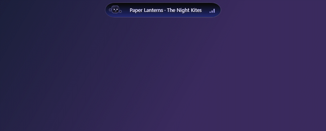

## See it move

Every clip shows one feature on its own. Everything in them is made up for the demo.

<table>
<tr>
<td width="50%" valign="top"><b>Music</b> The song playing in any app, with cover, controls, and a progress bar </td>
<td width="50%" valign="top"><b>Lyrics</b> Every line fills with light as it is sung 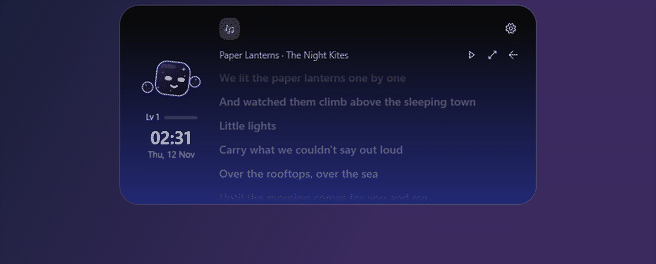</td>
</tr>
<tr>
<td width="50%" valign="top"><b>Song colors</b> The notch glows in the color of the album cover 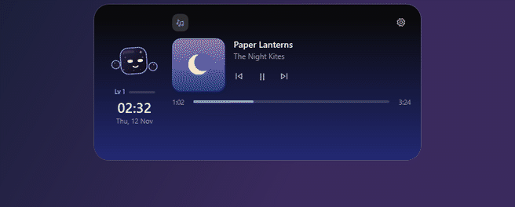</td>
<td width="50%" valign="top"><b>The mascot</b> A little night-sky cube that dances on the beat of your music 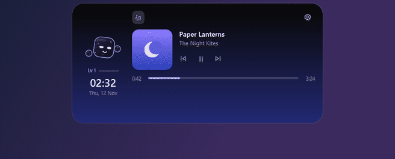</td>
</tr>
<tr>
<td width="50%" valign="top"><b>Timers</b> Focus sessions, a countdown, and a stopwatch </td>
<td width="50%" valign="top"><b>Focus chart</b> How long you focused on each of the last seven days 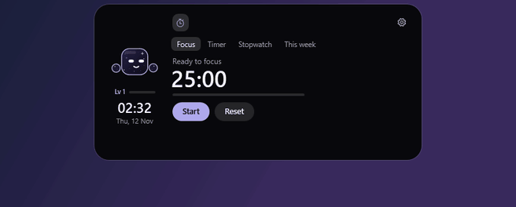</td>
</tr>
<tr>
<td width="50%" valign="top"><b>Quick timer</b> Pull down from the notch and let go on 5, 10, or 25 minutes </td>
<td width="50%" valign="top"><b>To-do</b> A short task list that gives you XP 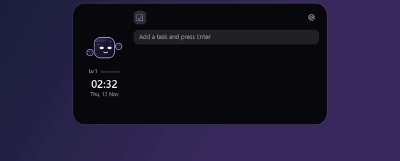</td>
</tr>
<tr>
<td width="50%" valign="top"><b>Calendar</b> A month view with your own events and reminders 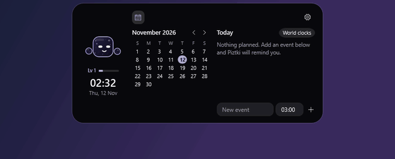</td>
<td width="50%" valign="top"><b>Water</b> Count your glasses through the day 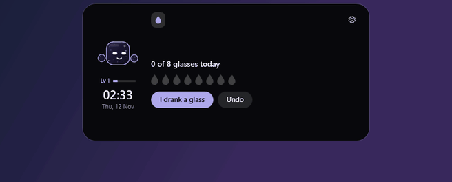</td>
</tr>
<tr>
<td width="50%" valign="top"><b>Shelf</b> Park files on the notch, drag them out later 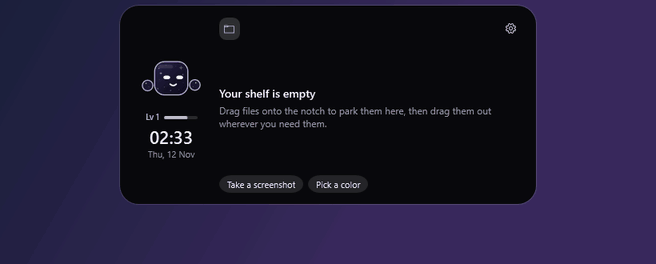</td>
<td width="50%" valign="top"><b>Clipboard</b> The last few things you copied 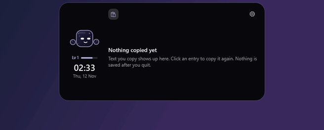</td>
</tr>
<tr>
<td width="50%" valign="top"><b>System</b> Processor, memory, network speed, and device batteries 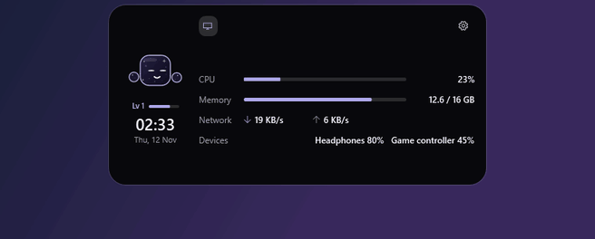</td>
<td width="50%" valign="top"><b>Notes</b> Quick notes that save by themselves 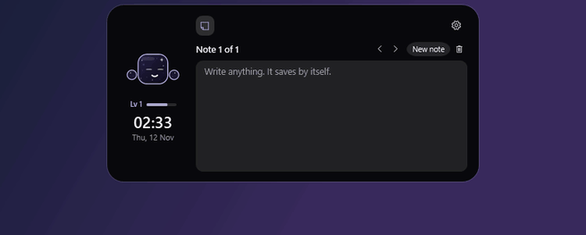</td>
</tr>
<tr>
<td width="50%" valign="top"><b>Shortcuts</b> Pin the apps and folders you open most 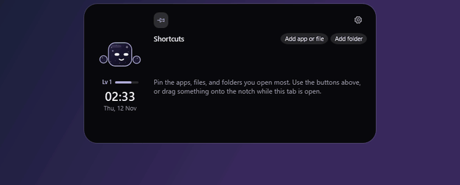</td>
<td width="50%" valign="top"><b>Search box</b> Sums, unit conversions, apps, and files 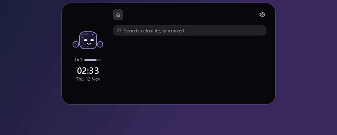</td>
</tr>
<tr>
<td width="50%" valign="top"><b>Themes</b> Midnight, Neon, Glass, and Pastel 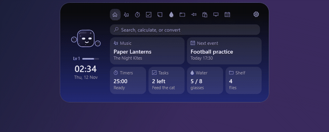</td>
<td width="50%" valign="top"><b>Downloads</b> Shows a file while it downloads and tells you when it's done </td>
</tr>
<tr>
<td width="50%" valign="top"><b>Microphone and camera dots</b> A dot while an app is listening or watching </td>
<td width="50%" valign="top"><b>Notifications</b> Messages from other apps show for a few seconds </td>
</tr>
<tr>
<td width="50%" valign="top"><b>Stretch reminders</b> A nudge to stand up after an hour at the screen </td>
<td width="50%" valign="top"><b>Popups</b> Caps Lock, internet status, and other small changes </td>
</tr>
<tr>
<td width="50%" valign="top"><b>Game summary</b> Your Fortnite result, and the Roblox game and server you joined </td>
<td width="50%" valign="top"><b>Game mode</b> Time, CPU, GPU, and memory while a game fills the screen </td>
</tr>
</table>

## What it does

- **Music**: the song playing in any app, with cover, controls, and a progress bar you can click
- **Lyrics**: the line being sung, live, filling with light as it goes, in the notch and in the pill
- **Lyrics page and Cinema**: the whole song scrolling as it plays, or on the full screen with the cover's colors drifting behind
- **Song colors**: the notch glows in the color of the album cover
- **Timers**: focus sessions with breaks, a countdown, and a stopwatch
- **To-do**: a short task list
- **Calendar**: a month view, your own events with reminders, two world clocks, the moon, and a countdown
- **Water**: count your glasses and get a nudge to drink
- **Shelf**: drag files onto the notch to park them, drag them out later
- **Clipboard**: the last few things you copied
- **System**: processor, memory, and network speed
- **Notes**: a few quick notes that save by themselves
- **Shortcuts**: pin the apps, files, and folders you open most
- **Sound**: a volume slider for every app, and a mute switch for the microphone
- **Screenshot**: drag over part of the screen and the picture lands on the shelf
- **Downloads**: shows a file while your browser downloads it and tells you when it's done
- **Microphone and camera dots**: a small dot while an app is using the microphone or the camera
- **Focus chart**: how long you focused on each of the last seven days
- **Search box**: opens apps and files, does sums, converts units and money, and starts a timer from "10m"
- **Quick timer**: press the notch, pull down, and let go on 5, 10, or 25 minutes
- **Notifications**: a new message or alert from any app shows in the notch for a few seconds
- **Color picker**: click any pixel on the screen to copy its color code
- **Stretch reminders**: a nudge to stand up after an hour at the screen
- **Themes**: Midnight, Neon, Glass, and Pastel
- **Game summary**: back in the Fortnite lobby, a small strip shows your place, eliminations, damage, and accuracy (read from the replay file Fortnite saves on your PC; replays must be on). Joining a Roblox game shows which game it is, where the server is, how many players are on it, and its average ping; leaving shows how long you played (read from the log file Roblox writes; the game is looked up on roblox.com by its number, and the server's city on ipwho.is by the server's address). A "last match" card on Home names the game
- **Game mode**: a tiny strip with the time, CPU, GPU, and memory while a game fills the screen (off until you switch it on)
- **Device batteries**: Bluetooth headphones, mice, and controllers that report a battery level
- **Discord**: your focus timer or song as a status on your profile, plus mute, deafen, and who is talking (needs your own free Discord application)
- **Weather**: the temperature in your city, under the clock
- **Popups**: volume, Caps Lock, keyboard language, battery, and internet status
- **The mascot**: moods, textures, hats, glow colors, and levels that grow as you get things done

Every feature can be switched off in Settings, and its tab disappears.

## Install

1. Download `Piztki-1.0.0-beta.1-win-x64.zip` from the [Releases page](https://github.com/yahavpenso/Piztki/releases).
2. Unzip it anywhere you like.
3. Run `Piztki.exe`.

Nothing else needs to be installed.

**Windows may show "Windows protected your PC" the first time.** That appears for any app that isn't sold through a store or signed with a paid certificate. Choose **More info**, then **Run anyway**.

Piztki adds itself to the Start menu the first time it runs, so you can search for it or pin it (switch off in Settings, General). To have Piztki start with your PC, open Settings (the gear in the notch) and turn on **Start with Windows**.

To quit, right-click the Piztki icon next to the clock and choose **Quit Piztki**.

## Requirements

- Windows 10 (version 2004 or newer) or Windows 11, 64-bit

## Uninstall

Switch off **Show in the Start menu** and **Start with Windows** in Settings first, so nothing is left pointing at the app.

Quit Piztki, delete `Piztki.exe`, and, if you want your data gone too, delete the folder `%LocalAppData%\Piztki`.

## Privacy

Piztki keeps your data on your own PC. A few features use free outside services, and only while they are switched on. The full details are in [PRIVACY.md](PRIVACY.md).

## Good to know

- Lyrics are timed line by line, so the fill inside a line is an estimate, not exact karaoke. If the words run early or late for you, adjust **Lyrics timing** in Settings, Music.
- Reminders for calendar events and timers only work while Piztki is running.
- Calendar events are stored on this PC only. They don't sync with Google or Outlook calendars.

## Thanks to

- Lyrics from [LRCLIB](https://lrclib.net), a free and open lyrics database
- Weather data by [Open-Meteo.com](https://open-meteo.com), under the CC BY 4.0 license
- Location lookup by [GeoJS](https://www.geojs.io)
- Sound analysis with [NAudio](https://github.com/naudio/NAudio), under the MIT license
